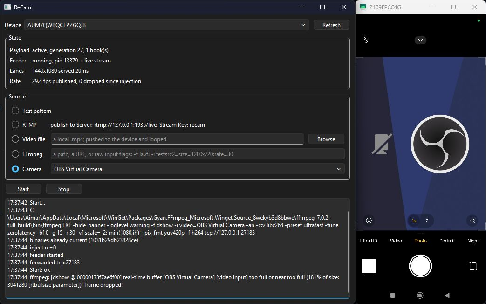

# ReCam

ReCam is a free, open-source Android virtual camera for authorized security testing.
It replaces camera frames inside `cameraserver`, letting apps receive a video file,
a desktop stream, or a physical or virtual webcam. Root is required; the target app
does not need modification.



## How it works

```text
Desktop source → FFmpeg → H.264 over ADB → device feeder → shared frame ring
                                                              ↓
                                                  camera buffer → Android app
```

The `recam` executable loads `librecam.so` into `cameraserver`. The payload replaces
supported camera buffers before they reach the app. Decoding and scaling run in a
separate feeder process, with four shared-memory lanes for different stream sizes.
Camera timestamps and capture metadata are preserved.

Live sources use H.264 in FLV over a forwarded TCP connection. Video files decode
and loop on the device.
**Stop** removes the hooks and restores the real camera.

## Requirements and downloads

- **Android:** a rooted 64-bit device running Android 11 or newer, working `su`,
  and USB debugging enabled.
- **Desktop:** `adb` and `ffmpeg` installed and available on `PATH`.

Download the archive for your platform from [Releases](https://github.com/aimardcr/ReCam/releases/latest):

| Platform | Available builds |
|---|---|
| Windows | x64, ARM64 |
| macOS 14+ | Apple Silicon, Intel |
| Linux | x64, built on Ubuntu 22.04 |
| Android CLI | ARM64, x86_64 |

Each architecture has its own archive. Desktop downloads include the Android ARM64
binaries. macOS builds are not notarized. `SHA256SUMS.txt` contains download checksums.

Compatibility depends on the device firmware, camera app, and buffer format.
Preview, saved photos, and recordings can use different paths. Unsupported formats,
including direct JPEG/BLOB and RAW outputs, pass through unchanged.
x86_64 is intended for emulator use.

## Using the desktop app

1. Extract the download and launch ReCam.
2. Connect the phone, authorize USB debugging, and grant root access when prompted.
3. Select the device and an input source, then press **Start**.
4. Open a camera app on the phone. Press **Stop** in ReCam to restore its real input.

| Source | Usage |
|---|---|
| Test pattern | Animated color bars; no media file required |
| Video file | Select a local video to upload and loop on the phone |
| FFmpeg | Enter a path, URL, or input flags such as `-f lavfi -i testsrc2=size=1280x720:rate=30` |
| Camera | Select a physical or virtual camera on Windows/Linux; on macOS use FFmpeg with AVFoundation input flags |
| RTMP | Press Start, then publish to the displayed server and stream key |

For **OBS Virtual Camera**, start the virtual camera in OBS, then select it under
**Camera** in ReCam. For **OBS RTMP**, select a Custom streaming service and use
`rtmp://127.0.0.1:1935/live` with stream key `recam` by default.

## Command line

Keep `recam` and `librecam.so` together and update both when upgrading. From an
extracted Android CLI archive, upload them:

```sh
adb push recam librecam.so /data/local/tmp/
adb shell
```

Inside the device shell:

```sh
su
cd /data/local/tmp
chmod 755 recam
./recam inject
./recam feed
```

Press Ctrl+C to stop the feeder, then run `./recam stop` to restore the real camera.

| Command | Purpose |
|---|---|
| `recam inject` | Load the payload and install camera hooks |
| `recam feed [FILE]` | Feed a video file, live stream, or test pattern |
| `recam stop` | Remove camera hooks |
| `recam status` | Print device, payload, and feeder state as JSON |
| `recam watch` | Re-inject if `cameraserver` restarts |

The feeder listens on device TCP port `27183` for FLV/AVC or raw Annex-B H.264.
Without a live sender, it plays `/data/local/tmp/recam_source.mp4` if present,
otherwise it generates the test pattern. The endpoint accepts plain TCP, not RTMP.
A custom live sender should use H.264 without B-frames and reconnect when changing
codec parameters.

## Logs

The desktop creates `logs/` beside the executable, outside the application bundle
on macOS, or in the repository when running from source. If that directory is not
writable, it uses `~/ReCam/logs/`. The UI displays the location.

Each session produces:

- `desktop-<pid>.log`: app events, ADB commands, FFmpeg output, and exceptions.
- `device-<pid>.log`: available Android logcat buffers.
- `payload-<pid>.log`: ReCam and C2D messages.

Logs rotate automatically. To [report a problem](https://github.com/aimardcr/ReCam/issues/new/choose),
reproduce it and attach the three files from the same session, including numbered
backups. Include the device, firmware, app, camera mode, and source. Review logs for
private information before sharing them.

## Building

Use Android NDK `27.3.13750724` and Python 3.13 to match the release environment.
Run these commands from the repository root, with `ndk-build` on `PATH`:

```sh
ndk-build NDK_PROJECT_PATH=android NDK_APPLICATION_MK=android/jni/Application.mk -j8
python -m pip install -r desktop/requirements.txt
python desktop/main.py
```

Device binaries are written to `android/libs/<ABI>/`; the desktop finds the ARM64
build automatically.

To create a desktop bundle on its target OS, set `ANDROID_NDK_HOME` to the NDK
installation directory, then run:

```sh
python -m pip install -r desktop/requirements.txt pyinstaller
python tools/package.py
```

Output is `dist/ReCam/`, or `dist/ReCam.app` on macOS. Use `--no-ndk` to package
existing device binaries, or `--no-freeze` to stage them without building the app.
`adb` and `ffmpeg` remain external dependencies.

The **Release build** GitHub Actions workflow builds all listed platforms. It
checks executable architectures and bundled payload hashes, then produces separate
archives, build metadata, and checksums in the `release-assets` artifact.
To share downloads without a GitHub sign-in, use an `-rc.N` version and enable
**Publish a public test release**. This creates a public prerelease.

## Components

| Path | Responsibility |
|---|---|
| `android/src/cli/` | `recam` command dispatch |
| `android/src/injector/` | Injection, symbol resolution, lifecycle, and status |
| `android/src/payload/` | Camera hooks, buffer access, and frame substitution |
| `android/src/feed/` | H.264 transport, MediaCodec decoding, and scaling |
| `android/src/common/` | Shared protocols, frame geometry, and ring ownership |
| `desktop/recam_ui/` | Qt interface, ADB control, streaming, and logging |
| `tools/` | Packaging and release archive generation |

## License

[MIT](LICENSE). ReCam includes [AndKittyInjector](https://github.com/MJx0/AndKittyInjector)
and [XZ Embedded](https://github.com/tukaani-project/xz-embedded); see [NOTICE](NOTICE)
for their licenses and attribution. Use ReCam only on systems you own or are
authorized to test.
